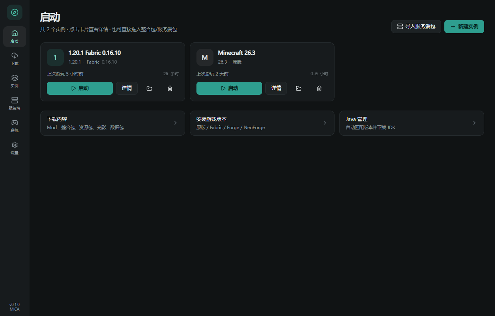
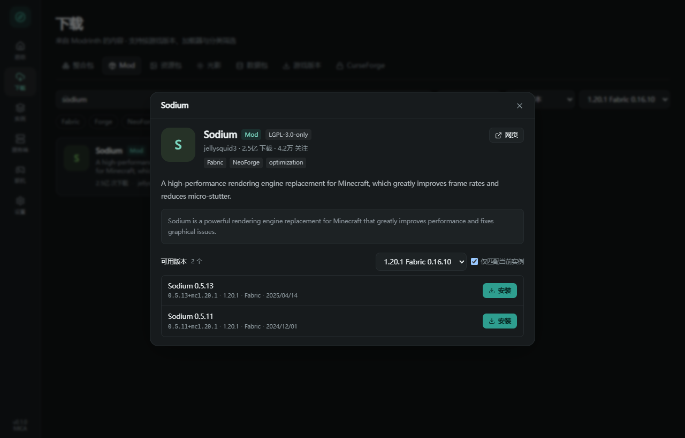
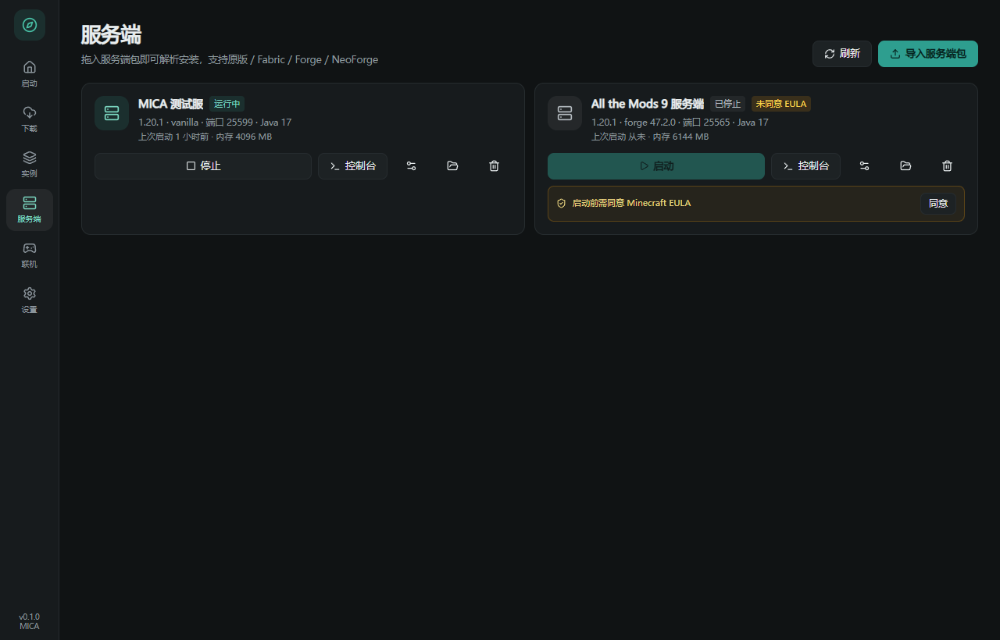
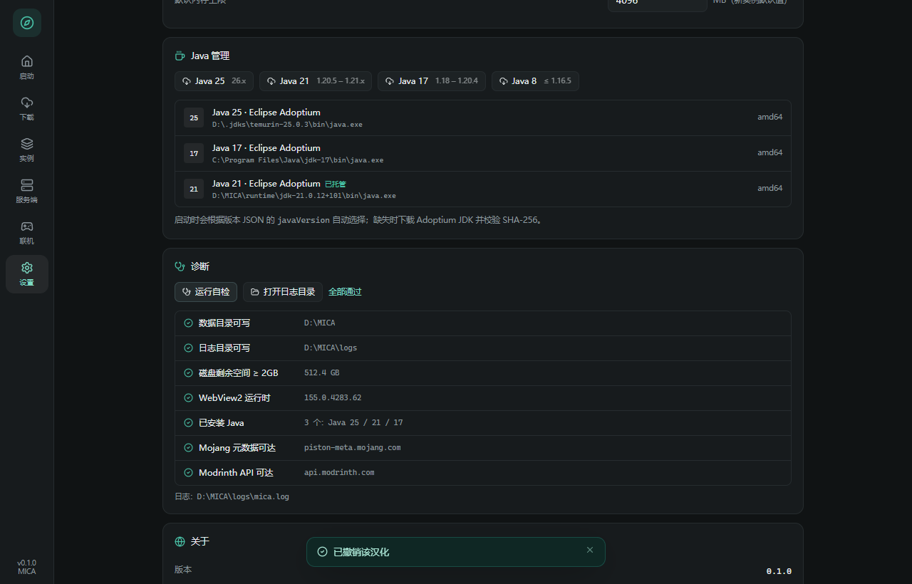

# MICA

**A lightweight Minecraft: Java Edition launcher for Windows** — Tauri 2 + Rust + React 19.
Single-file portable exe, no external dependencies, Modrinth catalog, instance isolation,
server packs and one-click localization.



> 一个简约风格的 Minecraft Java 版启动器。Tauri 2 + Rust + React 19。
> CurseForge 接入需 API 授权（申请材料见 docs）；联机功能暂为空壳。

---

## 功能一览

| 模块 | 状态 | 说明 |
|---|---|---|
| 原版下载 | ✅ | 全版本清单（900+ 版本，含 26.x / 1.x / 快照），libraries / assets / natives / client.jar 全量校验 |
| 启动游戏 | ✅ | 版本链合并（`inheritsFrom`）、规则求值、classpath、argfile、进程日志、退出码 |
| Fabric | ✅ | `profile/json` 直写安装，无需运行安装器；支持历史 loader 版本 |
| Forge | ✅ | maven-metadata + promotions 推荐版本；installer `--installClient` 安装 |
| NeoForge | ✅ | 版本列表与安装器流程已实现；官方 Maven 在部分网络不可达时支持拖入 installer.jar |
| 实例管理 | ✅ | 版本隔离、内存/Java 绑定、Mod 启停、日志查看、删除 |
| 服务端 | ✅ | 拖入服务端包自动识别（原版/Fabric/Forge/NeoForge）、安装、启动/停止、实时控制台、server.properties 编辑、EULA 确认 |
| 一键汉化 | ✅ | 选择汉化包 → 解包覆盖到实例（自动备份同名文件）→ 可逐条撤销 |
| Modrinth 内容中心 | ✅ | Mod / 整合包 / 资源包 / 光影 / 数据包；搜索、分类、加载器、游戏版本筛选、排序、分页 |
| 整合包安装 | ✅ | `.mrpack` 远程/拖入、MultiMC/Prism 实例包、通用 zip（覆盖策略）；CurseForge 包**识别但暂缓安装** |
| Java 管理 | ✅ | 自动探测（PATH/注册表/常见目录/托管目录）+ 按 `javaVersion` 匹配 + Mojang 运行时（快）+ Adoptium JDK 兜底 |
| CurseForge | ✅ | API Key 接入；搜索、详情、文件列表、单 mod 安装、整合包 manifest 安装；`downloadUrl` 为空转手动下载 |
| 联机 | 🧩 空壳 | 路由与能力位预留（`MultiplayerService`），无死按钮 |

---

## 快速开始

直接运行：`release\MICA.exe` —— **单文件、零依赖**。

- 唯一外部运行时是 **WebView2**：Win11 / 正常 Win10 已内置；若缺失，exe 内置的 1.8MB 引导器会自动静默安装（仅首次、约 1 分钟，无需手动装任何东西）。
- 不依赖 .NET、VC++ 运行库、Java（Java 由启动器按版本自动下载并校验）。
- 便携运行，不写注册表、不需要管理员权限；数据目录优先 `%APPDATA%\MICA`，不可写时自动回退到 exe 同级 `MICA-Data`。

### 体积与依赖（刻意保持轻量）

| 指标 | 数值 |
|---|---|
| 单文件大小 | **6.9 MB**（`opt-level="z"` + LTO + strip + panic=abort） |
| 外部 DLL | 0 个；PE 导入表仅 Windows 系统 DLL（无 VCRUNTIME/MSVCP） |
| 外部运行时 | 仅 WebView2；缺失时由 exe 内置的 1.8MB 引导器自动安装 |
| 启动 | 不再全盘扫描 Java，按需加载；首屏实测 0.2s |
| 前端 | 328 KB JS（gzip 100 KB），无重型 UI 库 |
| Rust 依赖 | 已裁掉 anyhow / tempfile / tracing / tracing-subscriber / quick-xml / dirs |

源码构建见下文；验收结果见 [docs/验收报告.md](docs/验收报告.md)（33 条全通过）。手工验收见 [docs/验收指南.md](docs/验收指南.md)。

## 界面

| 首页 | 项目详情 | 服务端 | 诊断 |
|---|---|---|---|
|  |  |  |  |

## 技术栈

- **壳**：Tauri 2（Rust 后端，WebView2 前端）
- **前端**：React 19 + TypeScript + Vite 7 + Tailwind CSS 3 + Zustand
- **后端**：tokio / reqwest(native-tls) / serde / zip / sha1 / sha2 / md-5 / regex
- **包管理**：pnpm；**构建**：Cargo

```
src-tauri/src/
├─ app.rs          Tauri 命令与事件（GUI 入口）
├─ cli.rs          命令行驱动（自动化验收 / 排障）
├─ install.rs      原版安装（libraries / assets / natives）
├─ loaders.rs      Fabric / Forge / NeoForge
├─ launch.rs       启动计划与进程
├─ modrinth.rs     Modrinth v2 客户端
├─ modpack.rs      整合包识别与安装
├─ java.rs         Java 探测 / Mojang 运行时 / Adoptium
├─ instances.rs    实例模型
├─ version.rs      版本 JSON 结构、规则、Maven 坐标、合并
├─ mojang.rs       官方元数据
├─ http.rs         客户端 / 镜像 / 断点续传
├─ archive.rs      ZIP（UTF-8/GBK 文件名、路径安全）
├─ paths.rs        数据目录布局
└─ reporter.rs     进度/日志上报
```

---

## 构建

前置：Node 20+、pnpm、Rust stable（MSVC）、Visual Studio Build Tools（C++ 工作负载 + Windows SDK）。

> **构建必须走 Tauri CLI**：直接 `cargo build --release` 不会启用 `custom-protocol`，窗口会去连 dev 服务器（`localhost:5173`）并报 `ERR_CONNECTION_REFUSED`。
> 发布产物请用 `pnpm tauri build` / `pnpm tauri build --no-bundle`。

```powershell
pnpm install
pnpm build                    # 前端产物 -> dist/
pnpm tauri build              # 发布构建（会启用 custom-protocol，产出可用的 exe/安装包）
pnpm app:build                # 同上
```

仅构建可执行文件（不打包）：

```powershell
pnpm tauri build --debug --no-bundle
# 产物：src-tauri/target/debug/mica.exe
```

本机若未把 MSVC 环境加入全局 PATH，可使用包装脚本：

```powershell
scripts\env.cmd pnpm tauri build
scripts\env.cmd cargo build --bin mica-cli
```

## 运行与数据目录

默认数据目录 `%APPDATA%\MICA`；若不可写会依次回退到 `%LOCALAPPDATA%\MICA`、可执行文件同级 `MICA-Data`、当前目录 `MICA-Data`。

可用环境变量覆盖：

```powershell
$env:MICA_DATA_DIR = "D:\MICA"
```

目录结构与官方 `.minecraft` 同构：`assets/ libraries/ versions/ instances/ runtime/ cache/`。

## CLI（自动化验收用）

```powershell
mica-cli.exe --data <dir> info
mica-cli.exe --data <dir> manifest
mica-cli.exe --data <dir> install-vanilla 1.20.1
mica-cli.exe --data <dir> fabric-versions 1.20.1
mica-cli.exe --data <dir> install-fabric 1.20.1 --loader 0.16.10 --instance 1.20.1-fabric
mica-cli.exe --data <dir> forge-versions 1.20.1
mica-cli.exe --data <dir> install-forge 1.20.1 --loader 47.2.0 --instance 1.20.1-forge
mica-cli.exe --data <dir> neoforge-versions
mica-cli.exe --data <dir> install-neoforge 1.21.1 --loader 21.1.66
mica-cli.exe --data <dir> search mod sodium --game-version 1.20.1 --loader fabric
mica-cli.exe --data <dir> install-mod 1.20.1-fabric sodium --kind mod
mica-cli.exe --data <dir> detect-pack pack.zip
mica-cli.exe --data <dir> install-pack pack.zip --instance 1.20.1-fabric
mica-cli.exe --data <dir> install-modpack-remote fabulously-optimized
mica-cli.exe --data <dir> java-list
mica-cli.exe --data <dir> java-install 21
mica-cli.exe --data <dir> launch 1.20.1 --seconds 60
mica-cli.exe --data <dir> scan-mods 1.20.1-fabric
mica-cli.exe --data <dir> server-detect server.zip
mica-cli.exe --data <dir> server-install server.zip --mc 1.20.1 --loader vanilla --eula --name "我的服务端"
mica-cli.exe --data <dir> server-list
mica-cli.exe --data <dir> server-start <id> --seconds 75
mica-cli.exe --data <dir> server-props <id>
mica-cli.exe --data <dir> localize 1.20.1-fabric 汉化包.zip
mica-cli.exe --data <dir> localize-list 1.20.1-fabric
mica-cli.exe --data <dir> localize-rollback 1.20.1-fabric <recordId>
```

## 验收

- 20 条验收标准与逐条证据：[docs/验收报告.md](docs/验收报告.md)
- CurseForge 接入调研与 Key 权限实测：[docs/CurseForge接入调研.md](docs/CurseForge接入调研.md)
- CurseForge API 申请文案（中英）：[docs/CurseForge-API申请.md](docs/CurseForge-API申请.md)
- 自动化脚本：`scripts/acceptance-cli.ps1`、`scripts/acceptance-2.ps1`
- UI 截图脚本（浏览器 + 模拟 IPC）：`scripts/screenshot.mjs`

## 已知限制

1. **CurseForge**：需要 CurseForge for Studios 的 API Key，且 `downloadUrl` 可能因作者设置而为空；本次按约定只交付空壳。
2. **NeoForge**：`maven.neoforged.net` 在部分网络（含本次验收环境）DNS 不可达；已实现"拖入 installer.jar"兜底。
3. **微软登录**：当前仅离线账户；正版登录需 Azure 应用注册，留待后续。
4. **Quilt**：加载器安装未实现（整合包若声明 Quilt 会明确报错）。
5. **沙箱环境**：在受限文件系统下 `%APPDATA%` 可能不可写，启动器会自动回退（已实现并验证）。

## 许可与致谢

- 本项目为独立实现，**未复制** PCL / PCL CE 的任何源码；仅在架构与交互上参考了公开信息。
- 参考项目：[PCL](https://github.com/Meloong-Git/PCL)（分发有限许可）、[PCL CE](https://github.com/PCL-Community/PCL-CE)（Apache-2.0）、[PCL.Neo](https://github.com/PCL-Community/PCL.Neo)。
- 内容来源：[Modrinth API](https://docs.modrinth.com/api/)；游戏文件：[Mojang](https://piston-meta.mojang.com/mc/game/version_manifest_v2.json) / [Fabric](https://meta.fabricmc.net/) / [Forge](https://maven.minecraftforge.net/)。
- 联机设计预留参考：[Terracotta](https://github.com/PCL-Community/Terracotta-lib)、[PCL2-Lobby-Guide](https://github.com/PCL-Community/PCL2-Lobby-Guide)。

## License

MIT — see [LICENSE](LICENSE).

## Disclaimer

MICA is an independent project, not affiliated with Mojang, Microsoft or CurseForge.
It downloads game files from Mojang's official servers using the user's own account environment,
and does not redistribute any Minecraft assets, mods or CurseForge files.
